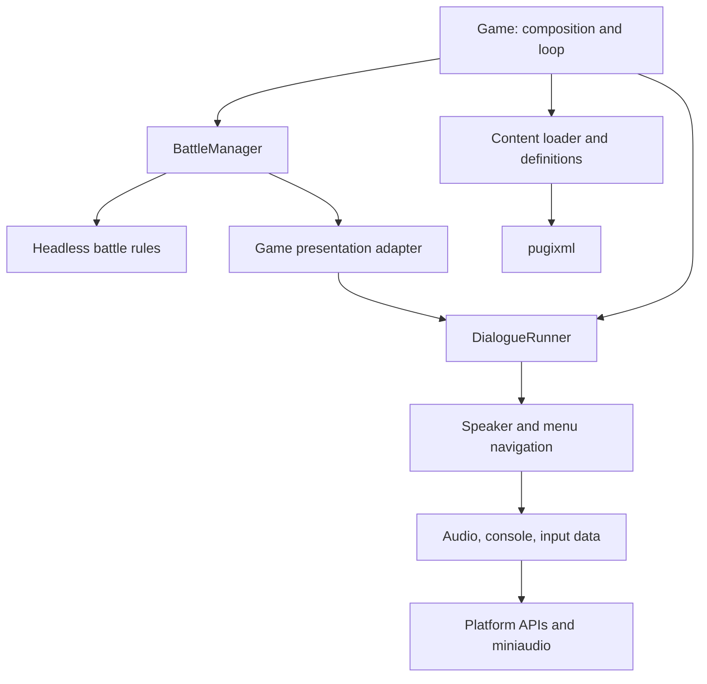

# FloweyFight: Refactor and Engine Plan

Revision: 2026-11-22 (reusable engine and boss-encounter direction clarified; repository baseline audited 2026-11-19; architecture revision originally 2026-10-25). This replaces the earlier conflicting R1–R9 order. Read this file for decisions and implementation order; read [DESIGN_NOTES.md](DESIGN_NOTES.md) for explanations, alternatives, and sources. `docs_old/` is historical, not a second set of instructions. The three redundant `_gpt.md` copies were compared with their active counterparts and removed; their text differed only in line endings.

This is a guided C++17 learning roadmap for a code-first JRPG engine/framework demonstrated by a playable boss-battle slice. [PROJECT_DIRECTION.md](PROJECT_DIRECTION.md) records the user's fine-tuned goals; this file is the sole M0–M8 implementation order and acceptance contract. The work in this revision is documentation, not an implementation of the game. Names and type sketches describe responsibilities rather than mandatory APIs.

## 0. Goals and scope

1. **Scalability and reuse:** build a reusable engine foundation and an intentionally reusable JRPG framework, not just shared helpers for Flowey. Flowey is one boss encounter, not the application's entire structure. Adding encounters, monsters, abilities, items, and dialogue built from supported mechanics should require data changes. A new mechanic can require code, but that change should stay near its rules and presentation rather than spread through the application.
2. **Transferability:** learn ownership, manual dependency injection, update loops, state machines, behavior composition, authored definitions versus runtime instances, commands, and presentation separation. Deliberately connect them to Unity through explanation and small separate exercises; Unity editor, scene/prefab, serialization, and lifecycle practice is still required. Unreal remains a useful secondary comparison, not a class hierarchy to copy.
3. **Conventionality:** use established solutions for recognizable problems. There is no single AAA/JRPG architecture. A pattern is justified by the responsibility it clarifies, not by its name.
4. **Sustainability:** build a small reusable core while continuing to play the game at each checkpoint. Adopt decoding, mixing, XML parsing, and a test framework. Defer editors, general scripting, physics, networking, ECS, and a universal engine framework.

When goals conflict, choose a conventional, transferable design that can be demonstrated in the next playable milestone. A second real use is stronger evidence for abstraction than an imagined future feature.

### Reusable engine and JRPG direction — clarified 2026-11-22

The user wants to learn how to make a game, with the option to rewrite this battle's lore and expand into a comprehensive JRPG. Structure the current playable slice as one distinct boss encounter within that possible game. Reusability is an explicit design goal now, even though completing a second game or a full campaign is not a current deliverable.

Keep three responsibilities separate:

- **Reusable engine (`src/engine`):** platform input/output, audio resources, text presentation, menu navigation, and generic dialogue execution. These accept supplied data/dependencies and do not know Flowey, particular filenames, battle outcomes, or the campaign's rules.
- **Reusable JRPG framework (initially `src/game`):** combatants, abilities, inventory mechanics, battle rules, turn/action progression, encounter contracts, and genre definitions. These should support a future JRPG as well as another encounter; the current folder is a starting location, not a permanent tie to Flowey. Distinguish shared mechanics from this game's session composition, story, and content bindings. Extract a module/library when actual dependencies demonstrate its boundary rather than moving all reusable code into the foundation.
- **Encounter content and behavior (`src/game` and authored data):** Flowey's identity, lore, dialogue, opponent setup, music, phases, special mechanics, and outcome-specific story progression. Supported variation belongs in data; a genuinely distinct boss mechanic may use localized game-side behavior without making the generic battle loop Flowey-specific.

Game/session owns state that survives a battle, such as the player, inventory, and story flags. BattleManager owns temporary encounter state and borrows the session state it needs. Starting an encounter supplies its definition and participants; finishing returns an outcome to game flow, which chooses the following dialogue/mode. Restarting or leaving a battle must not require restarting the process or rebuilding audio services. Exact types and persistence policies are settled when their milestones need them, not through an empty framework now.

Rewrite lore through authored content and game-side bindings rather than changes to engine services or core combat rules. Preserve current lore and behavior during the refactor; replacing them is a later authoring exercise. Distinct boss behavior is allowed, but it must have a defined entry point and encounter lifetime rather than scattered checks for a character name.

The intended proof is small: the same application can enter and leave a Flowey encounter and a second minimal encounter, with temporary battle state reset and intended session state preserved. Both use the same engine services and shared battle flow. This does not promise that new mechanics, an overworld, or a graphical frontend can be added without code changes.

### Engine architecture and combat-learning policy

Use a modular, layered architecture built through composition and explicit ownership. Application/game code owns the services; consumers receive narrow dependencies. Higher-level engine mechanisms may use lower-level services through small APIs, with no dependency cycles or game-specific content in the foundation. Interfaces belong at concrete substitution boundaries, not on every class. Reuse is demonstrated through clients, not the number of managers, abstractions, or folders.

The user's intended combat design is a shared vocabulary of modes/actions whose bosses are primarily subtractive: an encounter selects, restricts, configures, and sequences existing capabilities. Describe that vocabulary before expanding it, but implement it incrementally. A unified coordinator should sequence separable behavior rather than become a mega-object. Timing and dodge modes discussed in chat are candidate examples, not committed features. Introducing a mechanic outside the vocabulary requires an explicit game-design decision and localized implementation; do not silently turn each boss into an additive subsystem.

Use M4 to learn a small behavior component boundary from one real variation in action selection or encounter policy. Show two implementations/configurations sharing the same battle flow only where executable behavior actually differs; simple differences remain data. No ECS, component registry, live attach/detach framework, `FloweyBattle` subclass, or full interface hierarchy is required. Preserve rules/presentation and session/encounter boundaries regardless of the selected component.

### Learning direction and references

The user wants a small JRPG implementation inspired by Valyria Tear, with their own presentation and mechanics. Keep the current `src/engine` direction and grow `src/game` as responsibilities become real. Valyria Tear is a worked example to inspect selectively, not a folder/class checklist or a reason to adopt its singleton access, scripting language, or audio backend. XML and miniaudio remain the choices here. See DESIGN_NOTES section 10 for the inspected references.

The goal is a personally understandable, code-first, genre-focused toolset, with ZUN as an inspiration for authorship/control rather than an architectural specification. No GameMaker-style authoring workflow or visual editor is required. Useful tools and diagnostics are encouraged. The completed Pico presentation imposes no deadline here: learning and explaining decisions take priority.

Prepare for Unity deliberately through the milestone-linked comparisons and small exercises in DESIGN_NOTES section 10. Graphics will be a new topic, but it will not be the only one: editor workflows, engine-managed object lifetimes, asset importing/serialization, UI, and engine-specific scripting/build tools also require practice. Success means recognizing responsibilities and adapting them, not porting these C++ classes unchanged or treating our update loop as Unity's exact lifecycle.

Use *Game Programming Patterns* as a reference when a problem appears; reading the whole book is not a prerequisite. DESIGN_NOTES section 11 gives a short chapter-to-milestone path. Do not add a pattern merely because it has a chapter.

### Completion target

One console boss encounter supports the existing name-entry paths, dialogue, menus, attacks, defense, items, spells, agreed first-release special loadouts, flee, victory, and defeat. It remains responsive while text and delays run. Content is loaded from validated XML. A second monster, a minimal second encounter, and a new ability using existing effects can be added without editing the resolver, runner, or engine. The application can enter and leave those encounters through the same battle flow, and lore can be replaced through content/game-side bindings. See section 0's encounter/session boundaries and M8's extension check.

Scope clarification from the audit: Buster/Limit/Chaos currently exist as name lists and design comments, not working loadout/gauge mechanics. The sentence above retains their planned place, but M6 must explicitly agree which of those mechanics belong in the first release before implementing them. Do not report them as existing behavior to preserve, or silently turn every listed name into a prerequisite for finishing the core refactor. This scope decision does not block M1–M5.

An overworld, a complete campaign, and ATB are extension examples, not commitments for this refactor. Design for reuse across applications/JRPGs now and include a tiny independent engine-client probe in M8; shipping a separate second game remains a later test, not a condition for finishing this slice.

## 1. Starting point and working rules

### 1.1 Verified repository snapshot — 2026-11-19

This snapshot comes from inspecting the working tree and running a build. Recheck it when resuming; it is not a permanent completion claim.

| Area | Observed state |
|---|---|
| Git | Branch `modularize`; local edits and staged archive files already exist. Tracking information reports one commit behind `origin/modularize`; no fetch/merge was performed. |
| Build | Visual Studio 2022 Debug build succeeded. Warnings include numeric conversions in `audio.cpp` and unused `parsed` in `speaker.cpp`. Gameplay was not exercised. |
| Tools | `cmake` is absent from this shell's PATH. The existing cache points to Visual Studio's bundled CMake; see section 10. |
| Current layout | `main.cpp` plus engine audio/console/speaker/util pairs, `menu.h`, and `audio_manager.h`. Game state, combat, story, and startup still live in `main.cpp`; no `src/game/` yet. |
| Speaker | Old game helpers now forward to Speaker; the historical removed-call build failure is no longer reproduced. Four blocking write variants remain. Pause parsing is commented-out experimental code, not a working parser/Segment pipeline. |
| Audio | Four global engines plus an engine per Menu; mutable global `audioDir`; fire-and-forget blips; missing-file initialization calls `exit(0)`. AudioManager is an unused header skeleton with groups/map and a declared constructor, but no engine member or implementation. |
| Menus | Blocking input and non-inline implementations remain in `menu.h`; menu audio filenames are hard-coded there. The header currently compiles in this arrangement, but is not ready for inclusion by multiple implementation files. |
| Future systems | No Game owner, polling Input, DialogueRunner, BattleManager, XML loader, or tests target yet. Only miniaudio is currently vendored. |
| Existing housekeeping | Root README already describes the former dependency code becoming the engine; do not assume it still documents a subtree workflow. TODO generation in CMake is disabled; `gettodos` scans immediate `.cpp` files only. Archived TODO line numbers are stale. |

Current position: M0 has inspection/build evidence, but behavior capture remains incomplete. M1 has a successful compile, not its full playable checkpoint. An early M2 header draft exists; M2 is not complete. Do not restart already working call migrations or declare the intro/battle tested from a successful link alone.

#### 1.1.1 Audio reminder before the next build or play-test

**Remind the user before the next build, then recheck the files.** Missing audio does not prevent C++ compilation, but currently prevents a trustworthy gameplay smoke test. On 2026-11-19 these actively referenced files were absent from `audio/`:

- `menu_select.wav` — explicitly loaded during startup.
- `menu_navigate.wav`
- `menu_text.wav`
- `char_text.wav`
- `slash.wav`
- `start.wav`

`initSound()` currently calls `exit(0)` on load failure, so missing startup audio can terminate with a success exit code. Restore the needed local samples or verify the planned diagnostic/silent fallback before claiming a playable checkpoint. Only `AxeloFania_v1.wav` and `Dm9_G7_CM7_Am7.wav` are tracked audio; other local samples are ignored. `Enter Sanman_v1.wav` appears only in a commented-out call and is not an active requirement.

Paths currently resolve relative to the process working directory (`./audio/`), not automatically relative to the executable. The CMake audio-copy command is disabled. Until asset setup changes, launch from the repository root or deliberately provide the expected working-directory layout. Update/retire this reminder once assets and missing-file behavior are verified; do not keep warning about resolved files.

#### 1.1.2 Current-state refresh — 2026-11-22

Source inspection and a Visual Studio 2022 Debug build were repeated for this direction update; compilation succeeds. Gameplay was not run. The original 2026-11-19 snapshot remains historical: `src/game/` now exists, but its battle, character, player, enemy, game-manager, and Flowey headers are empty placeholders; `item.h` is a small draft. The repository is on `modularize`; existing documentation edits and untracked `FloweyFight.txt` were preserved. No fetch/merge was performed.

`audio_manager.h` is still an unused sketch with a string-keyed sound map, fixed groups, and a borrowed `ma_engine& audio_engine`; it has no implementation or CMake source entry. The running code still uses four file-scope engines and per-Menu engines. The vendored miniaudio header identifies itself as 0.11.23. All six audio files listed in section 1.1.1 are still absent and the old loader still calls `exit(0)` on failure, so a passing compile is not a playable checkpoint.

The next editing step is the smallest M2 ownership slice: replace the borrowed-engine sketch with owned storage and explicit initialization state, prevent accidental copy/move, then implement initialization and cleanup in `audio_manager.cpp`. Do not migrate every caller or redesign sound lookup in that first step. M1's asset/failure-path and smoke-test work remains open and must be resolved alongside that slice before claiming its playable checkpoint. Read DESIGN_NOTES section 7 and the pinned header before implementation.

### 1.2 Implementation discipline

- The user implements; assistance explains, reviews attempts, and fills requested gaps. Do not silently turn this roadmap into a large code rewrite.
- Work on `modularize` after checking its actual state. One focused change and green build per commit; leave unrelated edits intact.
- Use camelCase functions/variables, PascalCase types, lowercase file names, `#pragma once`, and the repository's `.clang-format`. Do not format vendored code.
- Put ordinary non-inline function definitions in `.cpp` files. Headers may define types, templates, and appropriate inline/constexpr functions or C++17 inline variables. Avoid mutable globals.
- Keep expected errors explicit. XML/content/audio failures return status and useful diagnostics; do not silently `exit(0)`. This does not imply that all standard-library allocation failures are recoverable or that the whole build must disable exceptions.
- Keep miniaudio's implementation in its single implementation translation unit for the **vendored version**. Do not replace that version merely because current upstream packaging differs.

## 2. The final product: who owns what

Think of the application as three jobs: hold the world, decide what happens, and present what happened. `Game` creates and connects those jobs.

| Component | Layer and owner | Responsibility and boundary |
|---|---|---|
| `Game` | game; constructed by `main` | Initializes services/content, owns session and modes, runs the outer loop, connects generic services to game behavior. |
| `Input` | engine; Game | Polls the platform once per outer frame; exposes actions such as Confirm/Cancel/Up/Down and text input. Knows keys, not spells. |
| `Console` | engine; Game | Terminal drawing, cursor/clear operations, output flushing, and restoration of changed terminal settings. Knows coordinates/text, not HP rules. |
| `AudioManager` | engine; Game | Owns one audio engine, mixing groups, stable sounds, and loading/playback status. Knows paths passed to it, not Flowey's asset names. |
| `Speaker` | engine; Game | Advances one text presentation at a time, including pauses and blips; borrows Console and AudioManager. Knows a voice description, not Combatant. |
| `MenuNavigator` | engine; owning screen or DialogueRunner | Tracks one menu's cursor/ancestor path and returns a selection token. Never spends MP or executes a battle. |
| `DialogueRunner` | engine; Game | Advances generic line/wait/choice/input/command steps. Borrows Speaker; owns its choice/input progress; calls game-bound command/query handlers. |
| `ContentDatabase` and XML loader | game; Game | Loads and validates game definitions, resolves IDs, and converts XML to owned C++ data. Supplies immutable definitions during play. |
| `StoryState` | game; Game/session | Stores player name, path, and story flags. Game handlers connect it to dialogue queries/commands. |
| `ModeController` | game; Game | Chooses Title/Intro/Battle/GameOver/Exit. Start with a small enum and explicit transitions; add an Overworld mode later. |
| `BattleManager` | game; Battle mode | Runs a supplied encounter; owns temporary battle instances, turn order, pending action, execution stage, and outcome. Borrows required session state, calls pure rule functions, and requests presentation. Does not own the whole campaign or choose Flowey's ending. |
| Battle rules | game; functions over explicit inputs | Validate costs/targets, resolve effects, and update combat state. No console, audio, sleep, dialogue runner, or XML calls. |
| Battle presentation | game; Battle mode | Maps action results and content IDs to dialogue, sound, and display changes. Can begin as a few functions rather than a new framework. |

`main` constructs Game and returns its run result. Game owns services by value or unique ownership, not through global accessors. Give each consumer only what it needs; `Speaker(AudioManager&, Console&)` does not need a reference to all of Game.

### 2.1 Dependencies and lifetimes



Arrows show allowed dependency direction, not every object member or update call. BattleManager coordinates rules and presentation; the rule functions call neither the manager nor the presenter.

Engine code never includes `game/` or hard-codes story names, filenames, and battle rules. Engine modules **may** depend on other engine modules: Speaker using audio is valid. Keep the include graph acyclic and the lower-level modules independent of their consumers. Do not move unrelated code into `util` just to avoid a sideways arrow.

Construct services before their borrowers. Destroy the active mode, stop the runner, and unregister game callbacks before their captured state or content disappears. Stop/release Speaker and dialogue references before destroying AudioManager. AudioManager releases sounds, then groups, then its engine. The platform layer restores terminal settings on normal shutdown and initialization failure.

Content is loaded completely and frozen before starting play. Use typed IDs (`AbilityId`, `VoiceId`, `MonsterTypeId`, `SoundId`) rather than long-lived pointers into vectors that might grow. IDs are not interchangeable even if their backing value is an integer. Runtime IDs need not be stable across launches; XML uses stable authored string IDs. No unloading or hot reload in this scope.

## 3. One battle action, end to end

Example: the player chooses Bolt against Flowey.

1. Input produces a Confirm event. The battle menu consumes it and returns a token. Game code maps the token to `BattleAction { actorId, kind, abilityId, targetIds }`.
2. BattleManager validates the action. Invalid target or insufficient MP leaves the player choosing; no cost is spent and no turn is consumed.
3. It locks in the pending action and starts the cast presentation. The dialogue runner and Speaker advance across frames; the battle does not accept another action.
4. When the cast presentation completes, BattleManager invokes the rule resolver **once**. The resolver revalidates, deducts the cost, applies effects in order, and returns an `ActionResult` containing actual outcomes and values needed for presentation. It does not print, play sounds, or wait.
5. The battle presenter uses that result to show impact text, HP changes, and reactions. Gameplay HP is authoritative at the commit point; displayed values can animate toward the recorded result. Cosmetic skipping never applies or cancels damage a second time.
6. When presentation finishes, BattleManager checks outcome before scheduling another actor. A defeated enemy does not receive a turn. If the fight continues, it ends the actor's turn and advances the scheduler.

This is a staged action execution, with one instantaneous rules commit inside it. The stages solve sequencing; the resolver solves arithmetic and effects. Neither is a second dialogue engine.

### 3.1 Battle phases and commands

Use one phase vocabulary everywhere: `BeginTurn`, `ChooseAction`, `PresentCast`, `CommitAction`, `PresentResult`, `EndTurn`, `CheckOutcome`, `Finished`. `ChooseAction` uses either the player's menu or enemy AI to produce the same BattleAction value. `CheckOutcome` also runs after a rules operation that could end combat; it is not delayed until an enemy has acted.

A BattleAction is a command represented as data. A separate subclass and virtual `execute()` per spell is unnecessary. Commands can later gain an interface if genuinely different execution behavior needs one. The shared action pipeline follows the Command pattern's separation of choosing an action from carrying it out [N3 in DESIGN_NOTES].

Initial action kinds are Attack, Ability, Item, Defend, and Flee. Targetless actions need no fabricated enemy target. Items validate inventory and consume once at commit; Defend applies its protection rule; Flee preserves the current escape/turn-consumption policy until an intentional gameplay change. Their results can include Escaped as well as victory/defeat. On Finished, BattleManager reports the outcome to its mode; game story code chooses the corresponding ending sequence and eventual mode transition. The engine runner never decides who won.

Initially schedule the existing player/enemy alternation. A small scheduler owns actor order and skip counts. Add speed ordering only when required by gameplay; document tie-breaking. ATB would replace scheduler policy and add time-based readiness, not arrive automatically from sorting by speed.

Attack timing later fits between action validation and commit: the minigame updates on the same loop and returns accuracy in `[0, 1]`. Do not use a worker thread for ordinary input/timing. Treat threads/atomics as a separate optional exercise.

## 4. The loop, input, and pauses

### 4.1 Nonblocking work is the requirement

Use one outer loop: poll input, route it once, advance timed work, render changed output, pace the next frame. No `_getch`, `getline`, `sleep`, or audio-completion busy-wait inside final gameplay paths. Name entry becomes a text-input widget; a temporary blocking adapter is allowed only during migration and must be removed before declaring the loop complete.

For this learning roadmap, use a fixed update interval of `1/60 s` with an accumulator and explicit overload handling. This is a project choice, not proof that all engines or all console games require fixed updates. See [N1–N2 in DESIGN_NOTES].

| Concern | Chosen behavior |
|---|---|
| Clock | `steady_clock`; measure real elapsed time each outer iteration. |
| Accumulator | Add measured elapsed, clamped initially to 250 ms. |
| Update | Run `update(fixedDt)` while a full step remains, at most 5 steps per outer iteration. |
| Backlog after limit | Discard whole overdue steps, keep the fractional remainder, and count/log the event. The game slows during overload instead of spending unbounded time catching up. |
| Input | Route discrete events once per outer iteration. Never replay Confirm in every catch-up step. |
| Rendering | Render once after updates and only redraw changed console regions. |
| Pacing | Sleep until a future deadline when ahead; reset an overdue pacing deadline after a stall. Pacing does not determine simulated elapsed time. |

The 250 ms and 5-step limits are initial tuning values. Test a deliberate 500 ms stall. Do not promise deterministic cross-platform replays from this loop alone.

Give every timed object exactly one updater. In each fixed step, Game first calls `DialogueRunner::update(dt)`; the runner advances its active Speaker/timer/choice progress. Game then calls the active mode's `update(dt)`; BattleManager observes presentation completion or starts its next request. A newly started line begins advancing on the following step. Game does **not** also update Speaker separately. Input handling runs outside the catch-up loop, and mode requests are applied only at a safe boundary after callbacks return. If a mode must wait for dialogue completion, use the returned run result, not a second timer estimating its length.

### 4.2 Input ownership

Game routes actions to one active consumer: dialogue choice/text entry/line advance when a modal sequence is active; otherwise the current mode's menu or minigame. Speaker itself receives a skip request from the runner rather than polling the keyboard.

- Confirm while typing reveals the current line; another distinct press advances it.
- An input event is consumed once. After a modal transition, do not deliver remaining confirm/cancel events from the same input batch to a newly exposed menu. Preserve quit/window-system handling.
- Define menu-repeat behavior separately from a fresh press. `_kbhit()` only means a character is available; it does not by itself establish key-down edges. Windows console events can report press/release and repeat counts [N11].
- Begin with the actual supported platform. Hide Windows-specific input/output behind engine modules. A Linux backend is later work unless explicitly made a current requirement; ordinary terminal character input does not necessarily expose key releases.

### 4.3 What waits and what keeps updating

When dialogue owns input, BattleManager waits at its explicit presentation stage; Speaker, runner timers, rendering, and audio continue. A later overworld can stop movement while allowing ambient animation. A full Pause menu has a distinct policy. `DialogueRunner::isBusy()` is a useful status, not a global instruction to skip every update.

## 5. Audio, text, menus, and dialogue

### 5.1 AudioManager and Voice: chosen design

- One AudioManager owns one `ma_engine` and three groups: `Music`, `Sfx`, `Voice`. A louder line uses a per-line/per-sound gain, not a hard-coded `loudVoice` group.
- Load every required sound object before gameplay, including blips. Decode short sounds; initialize long music as streams. Here “preload” means prepare the resource before use; streaming music does not decode the whole track into memory.
- `load(path, group)` returns a typed SoundId or explicit failure. XML/game content owns authored sound names and paths. A game-side lookup resolves those names to SoundIds at load time; named fields remain convenient for a few built-in UI sounds. Never make IDs depend on a duplicated enum/load-order convention.
- Store initialized sounds at stable addresses, for example `vector<unique_ptr<SoundResource>>`. AudioManager is non-copyable/non-movable; its fixed group storage never relocates. Uninitialize only resources whose initialization succeeded.
- Use an owned restartable sound per blip. With multiple random blip samples, stop the previous active voice blip even when the next sample has a different SoundId. One instance per sample alone does not prevent different samples overlapping. Pool overlapping effects only when a real sound requires it.
- Speaker borrows `AudioManager&` and `Console&`, not `ma_engine&` or a group pointer. One Speaker handles the single dialogue text channel. Voice is engine-compatible data: blip IDs, character delay, pitch/gain defaults. Specific character profiles live in game content.
- Missing optional audio reports a diagnostic and maps to silence. Device initialization failure permits a valid muted AudioManager; playback remains safe. Invalid required gameplay data stops startup with a useful error. The two error classes have different policies.

Use public APIs from the pinned vendored header. Keep miniaudio types inside the audio implementation when practical; first establish a safe wrapper before introducing extra hiding mechanisms. AudioManager's initialization can return a status while the object remains safely destructible and usable in muted mode.

#### Build the manager in small pieces

Keep `audio_manager.h` beside `audio_manager.cpp`; retain `audio.h/.cpp` temporarily while callers migrate. The current header is a starting sketch, not an implemented service. No PImpl, general resource framework, asynchronous loader, or sound-instance pool is required for this milestone.

| Piece | Initial contract |
|---|---|
| Device lifetime | Own one engine; track initialization success; explicit initialization reports ready/muted status. Delete copy and move. Destruction cleans up only successfully initialized resources. |
| Groups | Own fixed Music/Sfx/Voice groups and their initialization state; initialize after the engine, release before it. Group names are generic engine concepts. |
| Sound storage | Own stable sound resources and issue typed SoundIds. A vector of individually owned resources is the initial recommendation; game content keeps the authored-name lookup. The existing string map is not a mistake, but is not a second required public lookup API. |
| Loading | Accept a path, group, and decode/stream choice; return an ID or diagnostic failure. Game config resolves the audio root; the manager does not discover Flowey filenames. |
| Playback | Add play/restart, stop, and group gain first; then seek, loop, pitch, and per-sound gain as the existing callers need them. Give resume and restart distinct meanings. Missing/invalid IDs are handled safely, including in muted mode. |
| Borrowers | Speaker and menus borrow the same service. Speaker tracks its active blip; restarting a new sample stops the previous blip. Neither creates another engine. |

Implementation order: (1) engine/groups and safe shutdown, (2) load and restart one real sound through an ID, including failure/mute checks, (3) migrate one Speaker path, (4) migrate remaining music/effects/menus and remove old engines/global root. Compile at each step; play-test with an available sample before broad caller changes. A small construction scope in `main` can establish ownership before M3 grows it into Game; migrating object construction must also remove dependent file-scope menus/Speakers. Do not build an empty Game framework solely to name the owner.

### 5.2 Speaker and segments

Speaker receives owned/resolved text segments and a voice profile, then advances character/segment indexes from elapsed time. Segments initially cover Text and Pause. Empty/silent voices are supported. Validate nonnegative delays; a zero-delay line reveals immediately without an infinite loop. Skipping reveals the remaining line and bypasses its pauses without emitting a burst of blips. Coalesce overdue blips so catch-up does not create an audio burst.

Merge the old `write`/`writeRand` variants into one core behavior before adding pause-tag features. During migration, a blocking adapter may use that parser; the final API starts a line and returns immediately. Typewriter progress counts visible text rather than XML/tag bytes. The first renderer may explicitly support ASCII; UTF-8 grapheme-aware typing and terminal-cell-width wrapping require deliberate later work, not a promise obtained by moving strings to XML.

### 5.3 Menus are navigation; actions belong to the game

A nested command menu is a general tree. `MenuNode` contains a label, enabled state/reason, optional selection token, and children. MenuNavigator owns a cursor and ancestor path. Selecting a leaf returns its token; BattleManager interprets it. This replaces index arithmetic and `goto` without making engine UI mutate combatants.

Game code builds inventory/spell menus from current data when opened. Prefer showing unaffordable abilities disabled with a reason; always revalidate at commit. Do not rebuild a tree while navigator pointers into it are active. Clear navigation references before rebuilding, or navigate through IDs/index paths. No per-menu audio engine and no file-scope menu construction that reads uninitialized game services.

Dialogue choices can reuse menu presentation/navigation. Dialogue flow itself is a **graph** with branches, shared destinations, and possible cycles; do not force it into the menu tree type.

### 5.4 DialogueRunner and game integration

The engine runner executes generic steps: Line, Wait, Choice, TextInput, Command, Branch, Jump, End. Implement only the subset needed at each milestone. Game's `playDialogue(id)` finds a DialogueSequence in ContentDatabase and calls the runner with that sequence. Speaker presents lines; MenuNavigator presents choices; the runner advances sequence position and waits for their completion.

The game registers a small explicit set of commands/queries for story flags, player name, or mode requests. The runner knows handler names and typed arguments; handlers know StoryState. Unknown handlers fail validation. Mode-changing commands request a transition that Game applies after the active update/callback returns. Do not destroy a running callback's owner mid-call or let arbitrary XML invoke arbitrary C++ functions.

This permits an engine runner to execute a game-authored story without including game headers. Start with simple named flags and comparisons; no general expression language, bytecode VM, or custom scripting language.

Each run returns Completed/Cancelled/Failed status to its caller. Default to one active sequence; reject a second start while busy instead of silently replacing it. Stopping a line stops its active blip and releases input ownership. A waiting battle stage must receive cancellation/failure and clear the pending presentation or transition to an explicit error/exit path; it must not wait forever.

#### What the first dialogue slice looks like

Think of a sequence as a small list of authored instructions, with labeled destinations added only when branching is needed. Start M3 with owned C++ data; M5 loads the same runtime representation from XML. This is an illustrative flow, not a frozen C++ API or XML schema:

```text
Game requests intro
  Line(flowey, [Text("Howdy!"), Pause(500 ms), Text(" I'm Flowey!")])
  WaitForConfirm
  TextInput -> registered game handler stores player name
  Branch(name/path) -> normal, Chara, or empty-name destination
  ...lines/choices appropriate to that path...
  Command(request Battle) -> Game applies transition after update returns
  End
```

WaitForConfirm above is the line's advance policy/illustrative confirm step, not a requirement to add a competing runner state vocabulary. A Line asks Speaker to start; the runner waits across updates while Speaker reveals its Text/Pause segments. A fresh Confirm reveals unfinished text; another advances. Choices borrow menu navigation and return a destination token. The runner owns sequence position, Speaker owns only line progress, and StoryState owns the name/flags. The engine does not compare the name to `Chara`; a validated registered game query does that.

First prove a line, timed pause, confirmation, cancellation, and name-entry response. Add only the branch/choice features required for the chosen intro path. Draw the intended console interaction and trace one sequence before choosing elaborate class hierarchies. Keep the current game voice and pacing; this split changes how the sequence runs, not the author's style. Later a graphical text box replaces line presentation while the sequence/rules boundaries remain useful.

## 6. Combat definitions, runtime state, and rules

### 6.1 Composition and definitions

| Type | Contents |
|---|---|
| `Stats` | Authored/base maxHp, maxMp, attack, defense, magic, magicDefense, speed. |
| `Combatant` | Runtime actor ID, name, base stats, currentHp/currentMp, active statuses, learned AbilityIds, VoiceId. |
| `Player` | Contains a Combatant plus inventory, equipment, and gauge/loadout state. |
| `MonsterType` | Immutable authored stats, ability list, weighted attack choices, voice, and presentation IDs. |
| `Monster` | Contains a Combatant and MonsterTypeId. |
| `StatusDefinition` | Immutable modifiers, duration policy, stacking policy, and supported trigger kind. |
| `ActiveStatus` | Definition ID plus source actor, stacks, remaining duration, and expiry data. |

Player and Monster **contain** Combatant; the `:` notation in the previous sketch was ambiguous and is retired. Current HP/MP are runtime resources, not base stats to recompute from a type definition. Clamp them after damage/heal and changes to effective maxima.

MonsterType is the Type Object idea [N4]: another monster using supported behavior needs a definition, not a subclass. Boss mechanics can add localized code when existing behavior cannot express them.

### 6.2 Abilities and effects

An AbilityDefinition describes ID, display name, cost, target rule, ordered effects, and optional presentation IDs. An Effect describes a supported operation such as Damage, Heal, ApplyStatus, DrainMp, or SkipTurns. Basic attack, items, and spells can share effect helpers without forcing every action into the exact same authored schema.

The resolver accepts combat state, an action, definitions, and an explicit RNG. It validates the whole action before mutations, spends the cost once, applies ordered effects, and returns success/failure and per-target results. Return semantic results such as DamageDealt/Healed/Immune/StatusApplied, with values; game presentation selects text and sounds. The small returned list is not a global event bus.

Initial targeting supports Self and OneEnemy. Add Ally/AllEnemies only when multiple actors exist; do not advertise implemented targeting that cannot be selected or tested. Define supported effect order and death behavior: a dead target cannot receive later offensive/status effects unless the effect explicitly permits it; resurrection is outside this scope.

### 6.3 Explicit numerical policies

These are proposed game rules, not a claim to reproduce Final Fantasy formulas. First preserve existing balance through named legacy behavior; change balance in a separate commit after behavior checks.

| Question | Target policy to document and test |
|---|---|
| MP percentage | Store authored percentage as an integer 0–100; cost is `ceil(maxMp * percent / 100)`, using a sufficiently wide intermediate. Zero percent costs zero. Use the same computed value for UI, validation, and spending. |
| Normal damage | Initial example: `raw = max(1, floor(powerMultiplier * effectiveMagic) - effectiveMagicDefense)`. Apply a positive element multiplier afterward and round down with a minimum of 1 for an ordinary hit. Pick power units explicitly. |
| Immunity/absorption | Represent explicitly. Immune gives zero; Absorb converts the calculated magnitude into healing. Neither goes through a minimum-damage clamp that changes zero/healing into damage. |
| Stat modifiers | `effective = (base + sum(additive)) * product(multipliers)`, then stat-specific rounding/clamping. Percent increase of 20% is multiplier 1.2; base stats stay unchanged. |
| Damage/resources | Integers for HP/MP and final changes; floating-point multipliers with explicit rounding. Tests assert semantic outcomes and chosen numerical rules. |

### 6.4 Status duration and turn order

Avoid an unexplained `durationTurns`. For ordinary temporary buffs, duration counts the recipient's completed turn opportunities. Newly applied buffs are armed to expire only after they survive the next start of that recipient's turn; applying one during its own turn does not expire it immediately at that turn's end. Record eligibility/expiry explicitly, not only an integer blindly decremented at every EndTurn.

SkipTurns is a scheduler counter consumed at the recipient's next BeginTurn; two means exactly two missed opportunities. Defense can be a distinct “until next BeginTurn” status, so defending protects the enemy action after the player's turn. Permanent item boosts have an explicit infinite duration. Add poison/periodic triggers only with a defined timing hook and outcome check.

Start with Refresh: repeated application resets duration without duplicating a modifier. Add Stack and Replace when content needs them, with tests and limits. Separate immutable definitions from ActiveStatus instance timers [N7].

Buster/Limit/Chaos are loadouts of AbilityIds and unlock conditions. Gauge costs use the same validation/commit discipline. Chaos boosts can modify damage and cost via supported status rules; Chaos Control delegates missed opportunities to the scheduler. A weighted AI selects only legal choices and has a defined fallback when none is legal. Cosmetic blip randomness must not consume the battle RNG stream.

## 7. XML and content loading

Keep external XML and adopt pugixml. The game loader interprets the game schema; the engine does not parse monster rules. XML loading is introduced after runtime structs work with a small in-memory fixture, so parsing and combat architecture are not debugged simultaneously.

An illustrative line, not the complete schema:

```xml
<dialogue id="intro_flowey">
  <line speaker="flowey">Howdy!<pause ms="500"/> I'm FLOWEY.</line>
  <confirm/>
</dialogue>
```

Before M5, write a short schema contract for the subset actually used. A practical initial inventory is:

| Authored record | Required relationships |
|---|---|
| Sound | Unique ID, path, group, load mode; optional-sample fallback policy. |
| Voice | Unique ID, list of sound references, reveal delay and optional pitch/gain. |
| Ability | Unique ID/name, cost kind/value, target rule, ordered effects, optional cast/result dialogue references. |
| Monster type | Unique ID/name, base stats, ability references, nonnegative weighted AI choices, voice reference. |
| Encounter | Unique ID, opponent definition references, supported setup/presentation references, and game-flow bindings for outcomes. Define only the subset needed to launch and leave the first battle; do not invent a campaign scripting framework. |
| Dialogue sequence/node | Unique destination IDs, ordered generic steps, speaker references, explicit line-advance behavior and validated destinations/handlers. |

Add item/status records when those mechanics migrate. This table is the runtime contract to formalize into XML attributes/elements, not a claim that a full schema or loader already exists. Keep examples in tests synchronized with that contract.

Build owned Text/Pause segments by traversing all children in order. Define how `confirm` maps to the runner's line-advance behavior; do not assume an XML element is already a runtime state. Preserve intentional spaces in lines; ignore formatting indentation outside text-bearing elements. Do not use `text()` alone for mixed content.

Load in passes: parse files; construct definitions with unique authored IDs; resolve cross-references and sound IDs; validate values/commands/branch destinations; publish ContentDatabase only on success. Copy strings into owned data before destroying the XML document. Never leave borrowed XML-node/string views dangling.

Validation covers missing attributes, duplicate IDs, unknown references, invalid enum names, trailing junk/overflow in numbers, negative durations, invalid target/effect combinations, and invalid AI weights. Parse numbers with `from_chars` and require full consumption/range checks. Diagnostics name file, definition ID, and field; parser errors also report description and offset. Cycles in dialogue are allowed intentionally; cap immediate runner steps per update to prevent a no-wait cycle freezing the game.

Use `PUGIXML_NO_EXCEPTIONS` consistently across the library and its consumers if that configuration is selected. pugixml is not a game-schema validator. Runtime schema checks remain our responsibility [N9].

Retain the existing `|500|` parser only as a temporary adapter or a separate exercise. Both it and XML produce the same segments. Do not maintain two required authoring formats once content migration finishes. Malformed legacy tags print literally during migration; malformed external content fails validation before play.

## 8. Build/adopt boundaries and target layout

| Area | Decision |
|---|---|
| Input, console, timing | Build small wrappers over the supported platform and standard clock. |
| Audio | Adopt pinned miniaudio; build a small lifetime/playback wrapper. |
| Text, menu, dialogue sequencing | Build the narrow systems described above. |
| Combat and content semantics | Build game code; do not promote it into the generic engine. |
| XML | Adopt pinned pugixml; build the game-data conversion/validation layer. |
| Tests | Use doctest for one small test target. Catch2 v3 is also valid but is not a single-header-only default distribution. |
| Logging | Start with a diagnostic function or existing output helper; add a macro/library only for a concrete need. |
| Dependencies | Vendor the few chosen releases, record versions/licenses. FetchContent is optional and must pin versions; no package-manager migration is needed to finish. |
| ECS, event bus, scripting VM, editor, pools | Defer until a demonstrated problem justifies them. ECS is not only a performance technique, but this project does not currently need its organization or storage model. |

Suggested grouping; create files when responsibilities become real. Plain data can stay in headers. A module is not required to have a meaningless empty `.cpp`.

| Path | Responsibilities |
|---|---|
| `src/main.cpp` | Construct/run Game; report startup failure. |
| `src/engine/` | audio, console, input, speaker, menu_tree, dialogue_runner; small timing/random helpers as needed. |
| `src/game/` | game, modes, story, content_loader/content_database, combatant, status, ability, battle, items, voices/presentation bindings. |
| `data/` | dialogue, abilities, monster types, items, statuses, voice/audio manifest XML as needed. |
| `assets/audio/` | Existing audio moved only with a matching asset-path/CMake update. |
| `third-party/` | Pinned dependencies, their licenses, and miniaudio implementation source appropriate to its version. |
| `tests/` | Rules, parser/validation, and sequencing tests. |
| `docs/` | This plan, DESIGN_NOTES, regenerated TODO list. |

Initially keep the existing executable target and list new `.cpp` files explicitly. When the first headless rules tests arrive, put rule sources in a small `game_rules` library target shared by app/tests, or reuse an explicit source list; do not duplicate implementations. It must not link console/audio merely to test damage. A separate `engine` target can follow when it clarifies the real boundary, without making a second repo.

Use target-scoped includes and compile definitions. `SYSTEM` include paths can suppress third-party **header** warnings; they do not automatically suppress warnings from compiled vendor `.cpp` files [N12]. Keep project warning settings scoped appropriately.

## 9. Authoritative migration roadmap

Each milestone may take several focused commits. Move forward after its checkpoint works, not after every eventual file has been created. Preserve gameplay while migrating one path at a time.

| Milestone | Work and dependency | Exit checkpoint |
|---|---|---|
| M0 — Establish baseline | Inspect repository/branch, build, inventory missing audio and old TODOs. Record current name paths and battle behavior. | A concrete broken-call list or a working baseline; no claimed repo facts based solely on these documents. |
| M1 — Confirm green/playable baseline | Current compile is green; verify migrated Speaker/prompt/sound/clear behavior instead of assuming old missing calls remain. Resolve asset setup for smoke tests; fix remaining headers/one-definition risks. Preserve temporary blocking behavior. | Build and existing smoke paths work; explicitly record any unavailable paths. Commit before adding new dialogue features. |
| M2 — Own audio and services | Introduce AudioManager, SoundIds, stable resources and muted failure behavior; remove per-menu/voice engines and mutable audioDir. Game owns audio root/configuration. | Music, blips, effects, mute and missing-file behavior work. Speaker borrows the manager. No hidden static menu/audio initialization. |
| M3 — First responsive slice | Add polling input, bounded loop, minimal Game/mode shell, nonblocking Speaker and small in-memory DialogueRunner sequence. Port one intro path and name entry. | Text skips correctly, pauses/confirm/input work, quit remains responsive, a deliberate stall does not cause unbounded catch-up. A temporary legacy path may remain isolated. |
| M4 — Menu, rules, and component slice | Add MenuNavigator, Combatant runtime state, one ability, BattleAction/ActionResult, staged battle execution and tiny scheduler. Make encounter entry inputs and outcome return explicit; separate session state from temporary battle state. Record the intended shared combat vocabulary, implement only this slice, and learn one behavior component boundary from a real variation. Add doctest/headless rules target now. | A complete one-attack battle reaches win and lose without blocking and returns control to game flow; invalid actions spend nothing; a defeated actor never acts. A subsequent entry resets encounter state without reconstructing services. Demonstrate a supported encounter restriction and explain which differences are data versus executable behavior. No component registry or giant combat superset is needed. |
| M5 — Content pipeline | Add pugixml and game loader for the definitions already used. Convert the responsive intro and one battle fixture, including its minimal encounter setup, to XML; validate references and whitespace. | Same playable slice from external content, with clear failures for bad input. Runner and battle flow are reused, not rebuilt. |
| M6 — Complete battle behavior | Migrate defense/items, Bolt/Blizzara/Firaga, needed status policies and weighted AI. Express boss identity primarily through selection, restrictions, configuration, phase sequencing, and presentation within the shared vocabulary. Confirm first-release scope for the currently unimplemented loadouts/gauges and explicitly agree vocabulary extensions before adding them. Keep balance changes separate. | Full fight: each original action, agreed new mechanics, and both outcomes; status/cost/target tests pass; no legacy battle goto/globals remain. Custom behavior has a defined encounter boundary; shared systems contain no scattered Flowey identity checks. |
| M7 — Story and cleanup | Convert normal/Chara/empty-name paths and endings to data; keep Flowey lore and special behavior separate from shared JRPG flow. Remove remaining blocking adapters and obsolete helpers. Update README, asset-path instructions and recursive TODO generation. Retire subtree scripts only after verifying no longer used. | All completion-target paths pass; outcome-specific story transitions belong to game flow. No blocking gameplay waits, duplicate implementation macros, engine→game includes, or new hidden globals. |
| M8 — Prove reuse and finish this slice | Add a second monster, a minimal second encounter, and a new ability using supported effects through XML only. Exercise shared encounter flow/restrictions and alternate lore. Run a tiny independent client of selected engine services with no combat/Flowey dependency. Review the reusable JRPG module boundary and Unity learning checkpoints. | No resolver/runner/engine edits for the added content. Both encounters run in the same application; temporary state resets and intended session state persists. The second client links selected foundation services without Flowey/JRPG content. Record what reuse and Unity exercises actually demonstrated; a complete second game is not required. Choose the next expansion after this completed slice. |

Historical mapping only: old R1/R2/R4 mostly M1; R3/R5 M2; R9 M3; R6 M4; R7 spans M3–M7; R8 M7. Do not use the earlier R-number order as a second roadmap.

At suitable checkpoints, use the Unity comparison/exercise table in DESIGN_NOTES section 10. It supplements M2–M8 rather than creating another milestone sequence. Offer a small exercise when its concept is understood; do not create a Unity project or turn a comparison into a full port without the user's request. Record actual Unity practice separately from conceptual preparation.

## 10. Verification and extension boundaries

Configure with `cmake -S . -B build`; build with `cmake --build build`. Reconfigure when build configuration changes. Once tests are added, use `ctest --test-dir build --output-on-failure` (and the appropriate configuration option for a multi-config generator).

Before a build/play-test, recheck section 1.1.1 and remind the user if the audio issue remains. In the audited Windows environment, Visual Studio's bundled CMake built the default Debug configuration successfully; use this explicit Debug form when needed:

```powershell
& 'C:/Program Files/Microsoft Visual Studio/2022/Community/Common7/IDE/CommonExtensions/Microsoft/CMake/CMake/bin/cmake.exe' --build build --config Debug
```

This is a local tool location, not a portable project requirement. A successful compile does not prove audio availability, startup success, or playable paths. This documentation revision changes no gameplay code and does not require another build by itself.

Test meaningful rules: costs/rounding, immunity/absorption, modifier order, status refresh/expiry, two skipped opportunities, dead actors, legal weighted choices, and exactly one action commit. Feed controlled dt/input to sequencing tests: skip versus advance, dialogue cancellation, no-wait-cycle budget, and no confirmation leaking into the next menu. Test loaders with missing/duplicate IDs, unknown references and malformed numbers. These tests must not require a terminal or audio device.

Play-test after each responsive slice: name paths, full fight, defense, each item/spell, flee, win/lose, mute, and missing audio. Inspect actual project state rather than requiring a clean git tree that could contain the user's unrelated work. Commits should contain only the intended change.

Before declaring M8 complete, demonstrate the reusable boss-encounter structure without building an overworld: use a small game-flow selection/sequence to launch both encounter definitions in one process. Verify no previous opponent, pending action, battle-only status, or presentation request leaks into the next encounter, while intended player/inventory/story state survives. Document which statuses persist between battles rather than clearing all player effects by assumption. Review engine includes and asset references for game-specific dependencies. Run the tiny independent engine-client probe; it is a smoke application, not another game. Review which shared JRPG sources could form a library without depending on Flowey's story/content bindings. Only extract build targets where that boundary is real and tested. A second shipped JRPG remains a stronger, later reuse test.

Future features should preserve useful seams, not promise zero rewrites:

- Overworld: add mode, map data and movement; reuse input/audio/menus/runner.
- Graphical frontend: replace platform rendering and presenters; keep rules/content where their semantics remain valid. Console layout code will need changes.
- Party battles: extend actor/target selection and scheduler policy; reuse individual effect calculations.
- ATB: add a time-based scheduler and interaction policy.
- Save/load: serialize stable authored IDs and runtime state, not pointers, raw audio resources, or transient menu callbacks.
- Replays: require recorded inputs, controlled RNG and update behavior; a seed alone is insufficient.

## 11. Decision record and evidence

Resolved in this revision: one owner table; acyclic engine dependencies rather than a sibling ban; Speaker→AudioManager borrowing; three initial groups; authored audio names resolved to typed handles; menu selections returned as tokens; dialogue graph separate from menu tree; explicit modal input routing; staged nonblocking battle actions; separate definitions and runtime instances; bounded fixed-step policy; XML introduced after a working in-memory slice; one milestone order.

2026-11-22 user clarification: engine reuse is an explicit goal, and Flowey should be structured as one distinct boss encounter in a potentially larger JRPG. This revision adds encounter/session boundaries and checks within M4–M8 while retaining the current battle-slice scope. These are project requirements and planned acceptance criteria, not claims of implemented behavior or a newly verified build baseline.

2026-11-22 fine-tuning: the user wants a code-first, genre-focused toolset with reusable foundation and JRPG framework, substantial control over authored behavior, primarily subtractive boss design over a shared combat vocabulary, a small component implementation as a learning exercise, and deliberate preparation for actual Unity use. PROJECT_DIRECTION records these goals; M0–M8 remains the single roadmap. The separate current-state refresh records a successful Debug compile and continuing missing-audio/runtime limitations; it does not mark the new architecture implemented.

The exact numerical balance, which status mechanics are truly needed, platform-backend scope, and vendored API version remain implementation checks. The policies above are proposed defaults that make the roadmap implementable; changing one requires updating the corresponding tests and both documents, not reopening the whole architecture.

See DESIGN_NOTES section 12 for primary sources and the distinction between verified API facts, pattern examples, and project-specific decisions. No claim about ZUN's private engine or a universal AAA standard is required to justify this design.
